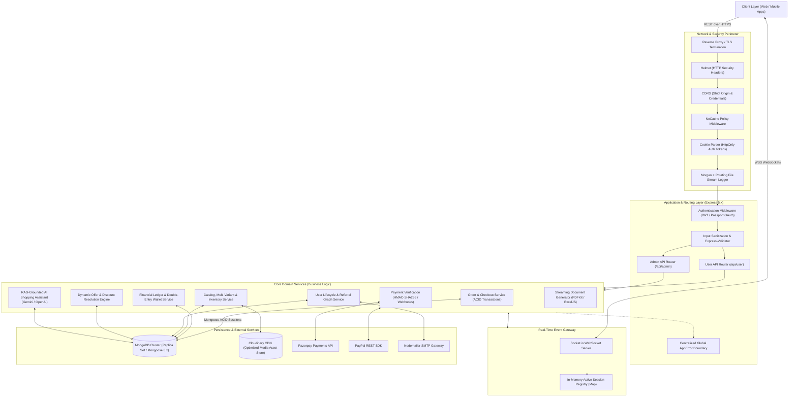
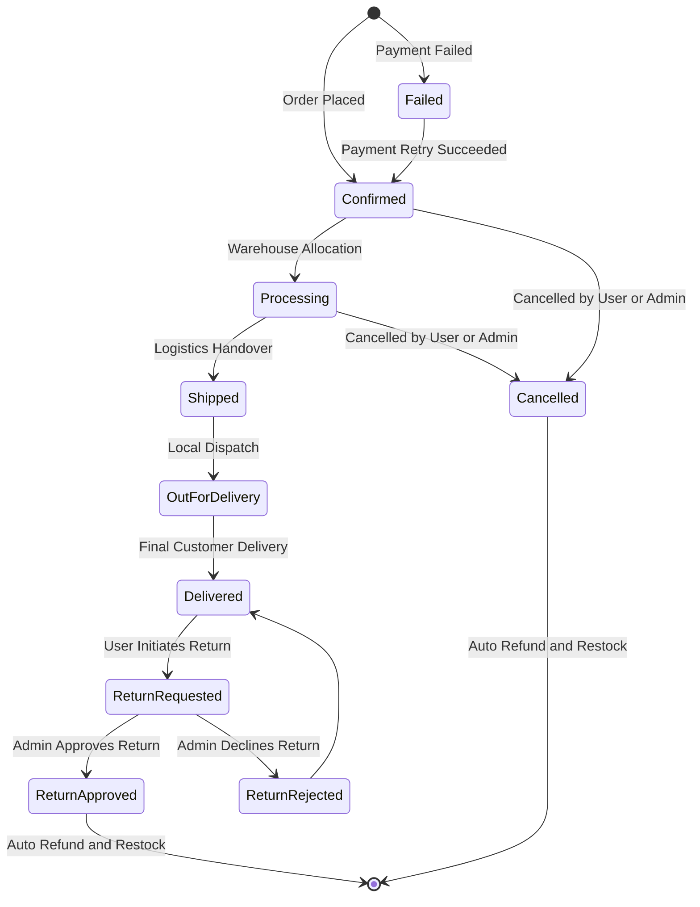
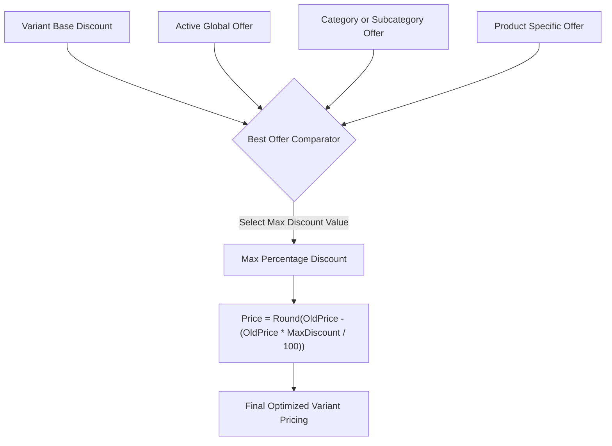

# Gratia E-Commerce API Engine (Backend)

[](https://nodejs.org/)
[](https://expressjs.com/)
[](https://www.mongodb.com/)
[](https://socket.io/)
[](https://www.docker.com/)
[]()

> A high-throughput, enterprise-grade REST and WebSocket backend powering a modern multi-tiered e-commerce platform. Architected with strict domain layering, ACID transaction guarantees, fine-grained Finite State Machine (FSM) order lifecycles, cryptographic payment verification, double-entry wallet ledger accounting, dynamic discount resolution, and LLM-grounded contextual shopping assistance.

---

## Architecture Blueprint

The server is built upon an enterprise **Layered Service-Oriented Architecture (SOA)**, strictly enforcing separation of concerns between protocol handling, request validation, business orchestration, and data persistence.



---

## Core Engineering Highlights

### 1. Concurrency-Safe Checkout via MongoDB ACID Transactions
To prevent race conditions, inventory overselling, and phantom reads during concurrent checkout surges, the order placement workflow executes within atomic multi-document transactions using Mongoose sessions:
- **Pre-execution Invariant Checks**: Verifies that neither the product, variant, nor any ancestor category (main, sub, or tertiary) is unlisted or administratively blocked.
- **Atomic Stock Reservation**: Atomically decrements variant inventory (`$inc: { stock: -quantity }`) guarded by boundary assertions.
- **Cart/Wishlist Synchronization**: Cleanses active cart and wishlist items within the identical transactional boundary.
- **Rollback Safety**: Any downstream failure (e.g., pricing discrepancy, concurrent out-of-stock collision) triggers `session.abortTransaction()`, returning the datastore to a clean state without orphan records.

### 2. Granular Item-Level Finite State Machine (FSM) & Status Rollup
Orders do not treat line items as a monolithic entity. Instead, each individual line item carries its own lifecycle, transition history, and audit log:



#### Deterministic Parent Order Rollup Matrix
A Mongoose `pre("save")` lifecycle hook evaluates the status vector of all child items to dynamically synthesize the top-level `orderStatus`:

| Target Parent `orderStatus` | Child Line Items Condition | Priority / Precedence |
| :--- | :--- | :--- |
| **`"Failed"`** | All items have `status === "Failed"` | 1 (Payment failure) |
| **`"Cancelled"`** | All items have `status === "Cancelled"` | 2 (Full cancellation) |
| **`"Return Approved"`** | All items have `status === "Return Approved"` | 3 (Full return) |
| **`"Completed"`** | All items have `status === "Delivered"` | 4 (Full delivery) |
| **`"Partially Delivered"`** | At least one item is `"Delivered"` while others are pending | 5 (Split fulfillment) |
| **`"Partially Shipped"`** | Any item is in `"Shipped"` or `"Out for Delivery"` | 6 (In-transit split) |
| **`"Processing"`** | Any item is `"Processing"` | 7 (Warehouse queue) |
| **`"Confirmed"`** | Default state when order items are placed and verified | 8 (Initial state) |

---

### 3. Double-Entry Financial Ledger (Digital Wallet Subsystem)
All refunds, rewards, and cashbacks pass through an immutable double-entry ledger (`WalletTransaction`):
- **Balance Invariance**: Direct wallet payments run under verification checks ensuring `balance >= orderTotal`.
- **Audit Trails**: Every ledger entry records `userId`, `amount`, `type` (`CREDIT` | `DEBIT`), `relatedOrderId`, and an explicit snapshot of `balanceAfter` to guarantee cryptographic and financial reconcilability.
- **Automated Refund Pipeline**: When an order item is cancelled or an admin approves a return, the exact monetary value of the line item (factoring in discounts and proportional coupon allocations) is automatically credited to the customer's wallet ledger with zero manual admin intervention.

---

### 4. Dynamic Hierarchical Offer Resolution Engine
Discounts can originate from multiple intersecting business layers. The system evaluates and resolves discount precedence dynamically at runtime:
1. **Global Offers**: Platform-wide promotional discounts constrained by ISO datetime windows.
2. **Category Hierarchy Offers**: Applied across primary, secondary, or tertiary category scopes.
3. **Product-Specific Offers**: Applied directly to targeted product IDs.
4. **Variant-Level Base Discounts**: Configured base markdowns on individual SKUs.



---

### 5. Resilient Payment Pipelines with Idempotent Retry
- **Cryptographic HMAC-SHA256 Verification**: Razorpay payment captures are verified on the backend by generating an HMAC hash using `crypto.createHmac("sha256", SECRET)` and comparing it against `razorpay_signature` to prevent client-side payment tampering.
- **Asynchronous Failed Payment Recovery**: If a network failure or 3D-Secure timeout occurs, the checkout pipeline does not discard the cart or drop the order. Instead, it marks the order as `Failed` with `filed: true` and preserves line item configuration, allowing the customer to re-attempt checkout without recreating their cart.
- **Dual Gateway Support**: Fully integrated with both **Razorpay** and **PayPal REST SDK** (Sandbox / Production).

---

### 6. Real-Time Socket.io Session Registry & Instant Forced Logout
The backend maintains an in-memory session registry mapping active users to WebSocket connections:
- **Registry Structure**: `onlineUsers: Map<UserId, SocketId>`
- **Immediate Administrative Revocation**: When an administrator blocks a compromised or abusive user via `/api/admin/users/block/:id`, the server updates the database, sends a security notification email, immediately inspects `onlineUsers`, and dispatches a high-priority `forceLogout` event to the target socket.
- **Zero-Latency Invalidation**: The client immediately purges local session tokens and terminates execution without waiting for access token expiration.

---

### 7. Grounded Retrieval-Augmented Generation (RAG) AI Assistant
The chat assistant (`/api/user/chat`) is integrated with `@google/genai` (Google Gemini) and `openai`:
- **Context Injection**: Before prompting the LLM, the service retrieves customer profile metadata and performs a contextual search in MongoDB for products matching user intent.
- **Anti-Hallucination Guardrails**: Real pricing, variants, and stock availability are injected into the system prompt, ensuring the model only recommends items currently in catalog with accurate prices.

---

### 8. Streaming Document Processing (Zero Memory Leak)
- **Vector PDF Invoices**: Generates enterprise-ready, multi-page vector invoices programmatically using `PDFKit`. Streamed directly over HTTP response streams via `doc.pipe(res)` without dumping intermediate files to disk.
- **Asynchronous Excel Sales Reports**: Formats multi-column business sales sheets with currency styling, transaction aggregates, and auto-adjusted column widths using `ExcelJS`. Temporary file buffers are unlinked immediately after download completion.

---

## Directory & Package Anatomy

```
Shpping cart Api/
├── config/
│   ├── connectDb.js             # Mongoose connection with retry semantics
│   ├── emailService.js          # Nodemailer SMTP transporter configuration
│   └── socketIo.js              # Socket.io server & active session map
├── controllers/                 # HTTP Transport layer (Request/Response orchestration)
│   ├── address.controller.js
│   ├── admin.controller.js
│   ├── cart.controller.js
│   ├── category.controller.js
│   ├── coupen.controller.js
│   ├── homeSlides.controller.js
│   ├── offers.controller.js
│   ├── order.controller.js      # Order placement, payments, analytics & reports
│   ├── product.controller.js
│   ├── size.controller.js
│   ├── user.controller.js       # Auth, Profile, Password, AI Assistant
│   ├── userManagement.controller.js
│   ├── wallet.controller.js
│   └── wishlist.controller.js
├── middlewares/                 # Pipeline filters & guards
│   ├── auth/
│   │   ├── adminAuth.js         # Admin JWT verification & token extraction
│   │   └── userAuth.js          # User JWT validation & blacklist check
│   ├── Error/
│   │   ├── appError.js          # Extended Error class with HTTP status codes
│   │   ├── asyncHandler.js      # Higher-order async route wrapper
│   │   └── globalErrorHandler.js# Centralized error formatter
│   ├── multer/
│   │   └── multer.js            # Multipart file upload storage configuration
│   └── validation/
│       ├── validationHandle.js  # Express-validator error serializer
│       └── validationSchamas.js # Input validation schemas
├── models/                      # MongoDB Schemas & Business Hooks
│   ├── address.model.js
│   ├── admin.model.js
│   ├── cart.mode.js
│   ├── category.model.js
│   ├── coupon.model.js
│   ├── homeSlides.model.js
│   ├── offers.model.js
│   ├── orders.model.js          # Order items FSM & auto-counter logic
│   ├── otpModel.js              # Ephemeral verification tokens
│   ├── product.model.js
│   ├── reveiw.model.js
│   ├── size.model.js
│   ├── user.model.js            # Auto-generated referral codes
│   ├── variant.schema.js        # SKU-level inventory, color, size, pricing
│   ├── wallet.model.js
│   ├── walletTransactions.model.js # Double-entry ledger
│   └── wishlist.model.js
├── routes/                      # Route definitions & sub-routers
│   ├── admin/                   # Admin protected endpoints
│   └── user/                    # Storefront & consumer endpoints
├── services/                    # Pure Domain Logic & Third-Party APIs
│   ├── address.service.js
│   ├── admin.service.js
│   ├── cart.service.js
│   ├── categories.service.js
│   ├── coupen.service.js
│   ├── homeSlides.service.js
│   ├── offers.service.js
│   ├── order.service.js
│   ├── product.service.js
│   ├── size.service.js
│   ├── user.service.js
│   ├── userManagement.service.js
│   ├── wallet.service.js
│   └── wishlist.service.js
├── utils/                       # Algorithmic & formatting helpers
│   ├── applyBestOffer.js        # Best-discount resolver
│   ├── generateAccessToken.js   # JWT minting (15m expiration)
│   ├── generateRefreshToken.js  # JWT minting (7d expiration)
│   ├── generateReferralCode.js  # Cryptographically random referral generator
│   ├── googleAuthSetup.js       # Passport Google OAuth 2.0 Strategy
│   ├── facebookAuthSetup.js     # Passport Facebook Strategy
│   ├── statusCodes.js           # Standardized HTTP status constants
│   └── *Template.js             # Responsive HTML email templates
├── Dockerfile                   # Production container definition
├── index.js                     # Application entry point & server bootstrap
└── package.json
```

---

## Security & Session Architecture

### Dual-Token Rotation via Secure Cookies
- **Short-Lived Access Token**: Signed with `JWT_KEY`, 15-minute validity window for operational requests.
- **Long-Lived Refresh Token**: Signed with `JWT_REFRESH_KEY`, 7-day validity window stored in MongoDB and rotated upon renewal.
- **Security Flags**: Stored exclusively within `HttpOnly`, `SameSite: Lax/None`, `Secure` (production) cookies, rendering them impervious to cross-site scripting (XSS) extraction.

### OAuth 2.0 Integration (Passport.js)
- **Google OAuth 2.0**: Scope limited to `profile` and `email` with `select_account` prompts.
- **Facebook OAuth**: Seamless social authentication with profile image ingestion.

### Input Sanitization & Attack Mitigation
- **SQL / NoSQL Injection**: Sanitized via Mongoose typed schemas and parameterized queries.
- **Cross-Site Request Forgery (CSRF)**: Mitigated through strict CORS configuration bound to authorized `FRONTEND_URL` and SameSite cookies.
- **HTTP Header Hardening**: Secured with `Helmet` (cross-origin resource policies, X-DNS-Prefetch-Control, frameguard).

---

## Primary API Endpoints Reference

### Consumer Storefront Endpoints (`/api/user`)

| Method | Endpoint | Authentication | Description |
| :--- | :--- | :--- | :--- |
| `POST` | `/register` | Public | Registers a new customer and sends verification OTP |
| `POST` | `/verify` | Public | Validates OTP and activates user account |
| `POST` | `/login` | Public | Authenticates credentials and sets auth cookies |
| `GET` | `/google` | Public | Initiates Google OAuth 2.0 handshake |
| `GET` | `/refresh` | Public (Cookie) | Rotates refresh token and issues fresh access token |
| `GET` | `/auth` | User Auth | Validates current user session and returns profile |
| `POST` | `/chat` | User Auth | Context-aware AI shopping recommendations |
| `POST` | `/cart` | User Auth | Adds/syncs SKU variants to user cart |
| `POST` | `/orders/placeOrder` | User Auth | Executes ACID transactional order placement |
| `POST` | `/orders/verifyRazorpay` | User Auth | Verifies Razorpay HMAC signature |
| `GET` | `/orders/invoice/:id` | User Auth | Streams programmatic PDF invoice |
| `PATCH` | `/orders/cancel/:id` | User Auth | Cancels line item, restores stock, credits wallet |
| `POST` | `/orders/return/:id` | User Auth | Submits a return request with audit justification |
| `GET` | `/wallet` | User Auth | Retrieves digital wallet balance and ledger history |

### Administrative Control Endpoints (`/api/admin`)

| Method | Endpoint | Authentication | Description |
| :--- | :--- | :--- | :--- |
| `POST` | `/login` | Public | Admin dashboard authentication |
| `GET` | `/auth` | Admin Auth | Validates administrative privileges |
| `GET` | `/users` | Admin Auth | Paginated user directory with search indexing |
| `PATCH` | `/users/block/:id` | Admin Auth | Toggles user status & fires Socket.io `forceLogout` |
| `POST` | `/products` | Admin Auth | Creates product & variants with Cloudinary upload |
| `PATCH` | `/orders/status/:id` | Admin Auth | Transitions item status through FSM lifecycle |
| `PATCH` | `/orders/return/approve/:id` | Admin Auth | Approves return, restores stock & triggers refund |
| `GET` | `/orders/sales/report/excel` | Admin Auth | Generates and downloads formatted `.xlsx` sales report |
| `GET` | `/orders/sales/report/pdf` | Admin Auth | Generates and downloads formatted `.pdf` sales report |
| `GET` | `/orders/chart/revenue` | Admin Auth | Aggregated revenue timeline for dashboard charts |

---

---

## Containerization & Docker Engine Architecture

The backend is fully containerized using an optimized, lightweight **Alpine Linux** footprint to ensure immutable deployments, minimal security attack surface, and deterministic runtime behavior across environments:

- **Base Image**: `node:alpine3.18`, keeping the final image footprint under 150 MB.
- **Layer Caching Optimization**: Package manifests (`package*.json`) are copied and installed independently before application source code to take advantage of Docker build layer caching.
- **Image Hygiene (`.dockerignore`)**: Excludes development artifacts (`node_modules`, `.env`, `.git`, log files) to prevent credential leaks and image bloat.

### Local Docker Commands
```bash
# 1. Build local container image
docker build -t nasif284/gracia-shopping-cart:latest .

# 2. Run isolated container with host port binding & environment injection
docker run -d \
  --name shopping-cart-app-container \
  --restart unless-stopped \
  -p 8000:8000 \
  --env-file .env \
  nasif284/gracia-shopping-cart:latest

# 3. View live runtime container logs
docker logs -f shopping-cart-app-container

# 4. Graceful container termination
docker stop shopping-cart-app-container && docker rm shopping-cart-app-container
```

---

## Automated CI/CD Deployment Pipeline (GitHub Actions)

Production delivery is orchestrated through an automated **Two-Stage Continuous Integration & Continuous Deployment (CI/CD)** pipeline declared in [`.github/workflows/cicd.yml`](.github/workflows/cicd.yml), deploying to a **Self-Hosted EC2 Linux Runner**:

```mermaid
flowchart LR
    Dev["Developer Git Push (main)"] --> GHA["GitHub Actions Runner"]
    
    subgraph BuildJob ["Job 1: Build & Publish (ubuntu-latest)"]
        Checkout["Checkout Code (actions/checkout@v4)"]
        DockerAuth["Authenticate to Docker Hub"]
        DockerBuild["Build Docker Image (node:alpine3.18)"]
        DockerPush["Push nasif284/gracia-shopping-cart:latest"]
    end
    
    subgraph DeployJob ["Job 2: Continuous Deployment (self-hosted / EC2)"]
        EnvInject["Write APP_ENV to /home/ubuntu/.env"]
        DropOld["Drop Previous Container (docker rm -f)"]
        PruneStorage["Reclaim Host Storage (docker system prune)"]
        PullImage["Pull Latest Image from Docker Hub"]
        RunContainer["Deploy Container (--restart unless-stopped)"]
    end
    
    GHA --> Checkout
    Checkout --> DockerAuth
    DockerAuth --> DockerBuild
    DockerBuild --> DockerPush
    DockerPush --> EnvInject
    EnvInject --> DropOld
    DropOld --> PruneStorage
    PruneStorage --> PullImage
    PullImage --> RunContainer
```



### Pipeline Workflow Breakdown

1. **Trigger Condition**:
   - Executes automatically on any code commit pushed to the production `main` branch.
2. **Job 1: `build` (GitHub-Hosted `ubuntu-latest`)**:
   - **Repository Ingestion**: Clones repository state using `actions/checkout@v4`.
   - **Registry Authentication**: Logs in to Docker Hub using encrypted repository secrets (`DOCKER_USERNAME`, `DOCKER_PASSWORD`).
   - **Container Compilation**: Builds the production image tagged as `nasif284/gracia-shopping-cart:latest`.
   - **Registry Push**: Uploads the immutable image artifact to Docker Hub.
3. **Job 2: `deploy` (Self-Hosted Runner on AWS EC2)**:
   - **Dependency Gate**: Configured with `needs: build`, guaranteeing deployments only proceed when image build succeeds.
   - **Zero-Exposure Secret Provisioning**: Writes production environment variables from encrypted GitHub Secret `${{ secrets.APP_ENV }}` directly into `/home/ubuntu/.env`.
   - **Safe Container Recycling**: Forcibly removes the deprecated container (`docker rm -f shopping-cart-app-container`).
   - **Automated Storage Hygiene**: Runs `docker system prune -a -f` to purge dangling image layers and avoid EC2 EBS volume exhaustion.
   - **Latest Image Ingestion**: Pulls fresh image layers from Docker Hub (`nasif284/gracia-shopping-cart:latest`).
   - **Zero-Downtime Daemon Execution**: Spawns the container daemonized with host port `8000:8000`, environment binding, and `--restart unless-stopped` crash recovery policy.

---

## Local Development Setup

```bash
# 1. Install project dependencies
npm install

# 2. Run in development mode (hot reloading via nodemon)
npm run dev

# 3. Code formatting & linting
npm run format
npm run lint
```

