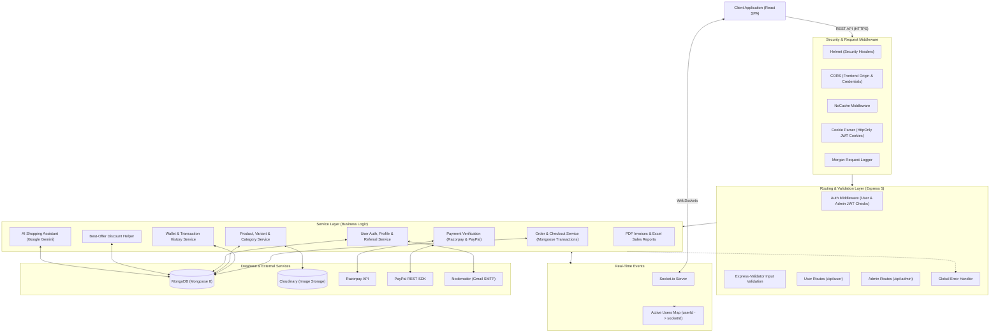
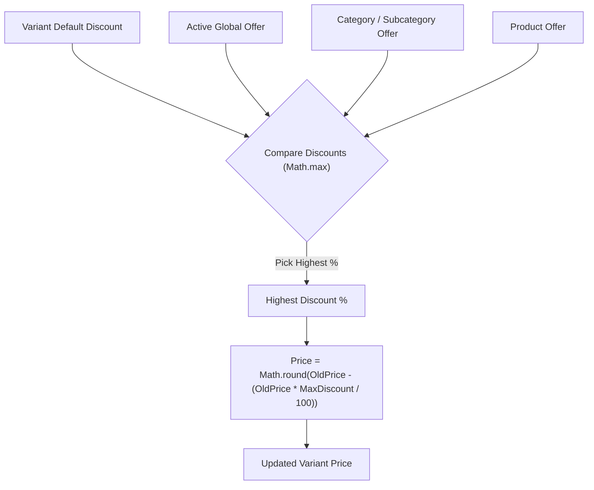
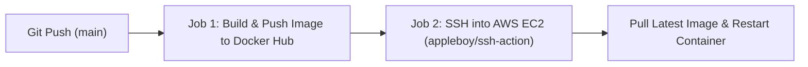

# Gratia E-Commerce Backend API

[](https://nodejs.org/)
[](https://expressjs.com/)
[](https://www.mongodb.com/)
[](https://socket.io/)
[](https://www.docker.com/)
[]()

> REST API and WebSocket backend for the **Gratia** e-commerce platform. Built with **Node.js**, **Express 5**, and **MongoDB (Mongoose)** using a clean Controller–Service–Model structure. Includes JWT + OAuth 2.0 authentication, MongoDB transactions for checkout, item-level order tracking, multi-gateway payments (Razorpay, PayPal, Wallet, COD), dynamic offer calculation, Socket.io real-time user blocking, PDF/Excel report generation, and a Google Gemini AI shopping assistant.

---

## Architecture Overview

The backend follows a **Controller–Service–Model** pattern to keep HTTP request handling, business logic, and database queries separated and easy to maintain.



---

## Key Features & Implementation Details

### 1. Safe Order Checkout with MongoDB Transactions
To prevent stock mismatches when placing an order, `placeOrderService` uses a **Mongoose Session & Transaction** (`session.startTransaction()`):
- **Availability & Stock Checks**: Verifies that the product, selected variant, and its categories (main, sub, and third-level) are not unlisted or blocked, and confirms `variant.stock >= item.quantity`.
- **Stock Deduction & Cart Cleanup**: Saves the order, decrements variant stock (`$inc: { stock: -item.quantity }`), and removes the purchased items from the user's cart and wishlist within the same session.
- **Automatic Rollback**: If any item is out of stock or an error occurs midway, `session.abortTransaction()` rolls back all changes so stock counts stay accurate.

---

### 2. Item-Level Order Tracking & Automatic Parent Status Updates
Instead of only tracking status on the whole order, each item inside an order has its own status (`Confirmed`, `Processing`, `Shipped`, `Out for Delivery`, `Delivered`, `Cancelled`, `Return Requested`, `Return Approved`, `Return Rejected`) and `statusHistory`.

 This allows customers to cancel or return a single item from a multi-item order. A Mongoose `pre("save")` hook on the order schema checks all item statuses and updates the overall `orderStatus` automatically:

| Overall `orderStatus` | Condition Across Order Items |
| :--- | :--- |
| **`"Failed"`** | All items have status `"Failed"` |
| **`"Cancelled"`** | All items have status `"Cancelled"` |
| **`"Return Approved"`** | All items have status `"Return Approved"` |
| **`"Completed"`** | All items have status `"Delivered"` |
| **`"Partially Delivered"`** | At least one item is `"Delivered"` while others are still in progress |
| **`"Partially Shipped"`** | Any item is `"Shipped"` or `"Out for Delivery"` |
| **`"Processing"`** | Any item is `"Processing"` |
| **`"Confirmed"`** | Default status when order is placed |

---

### 3. In-App Wallet & Automatic Refunds
Users have an in-app wallet (`Wallet` model) along with a transaction history log (`WalletTransaction` model):
- **Transaction Logs**: Every wallet credit or debit records the `userId`, `type` (`CREDIT` or `DEBIT`), `amount`, `description`, `relatedOrderId`, and `balanceAfter`.
- **Wallet Payments**: Users can pay for orders directly using their wallet balance if `wallet.balance >= orderTotal`.
- **Automatic Refunds**: When a paid order item is cancelled or a return request is approved by the admin, the refund amount (accounting for any coupon discounts applied to the order) is credited back to the user's wallet and the variant's stock is restored.

---

### 4. Automatic Best-Offer Calculation
Discounts can be created at different levels. The `applyBestOffer` helper checks all active offers applicable to a product variant and applies the highest discount:
1. **Global Offers**: Store-wide offers active within a start and expiry date range.
2. **Category Offers**: Discounts applied to a product's main category, subcategory, or third-level category.
3. **Product Offers**: Discounts created for a specific product.
4. **Variant Base Discount**: The default discount percentage set on the variant itself.



---

### 5. Payment Gateways & Failed Payment Retry
- **Razorpay (HMAC-SHA256 Verification)**: Verifies payments on the server using Node's `crypto.createHmac("sha256", secret)` to match `razorpay_signature` before marking an order as paid.
- **PayPal REST SDK & Cash on Delivery (COD)**: Supports PayPal sandbox/live payments and COD.
- **Failed Payment Retry**: If an online payment fails during checkout, the order is saved with status `"Failed"` instead of losing the items. The user can open the failed order from their account and retry the payment using Razorpay, PayPal, or Wallet.

---

### 6. Real-Time Forced Logout with Socket.io
The server keeps an in-memory map of connected users (`onlineUsers: Map<userId, socketId>`):
- When a logged-in user opens the app, the client emits `registerUser` with their `userId`.
- If an admin blocks that user from the Admin Panel (`/api/admin/users/block/:id`), the server updates `isBlocked: true` in MongoDB, sends an email notification, looks up the user's socket ID in `onlineUsers`, and emits a `forceLogout` event so the user is logged out immediately without waiting for their JWT access token to expire.

---

### 7. AI Shopping Assistant (Google Gemini)
The `/api/user/chat` endpoint integrates **Google Gemini (`gemini-2.5-flash` via `@google/genai`)**:
- **Keyword & Category Search**: Extracts keywords from the customer's message, checks for intent (such as top-rated or budget items), and queries MongoDB across product names, brands, tags, descriptions, and categories.
- **Catalog-Based Recommendations**: Passes the matching products (name, brand, price, discount, rating, and description) into the Gemini prompt so the assistant recommends real products from the store catalog.

---

### 8. PDF Invoices & Excel Sales Reports
- **Customer PDF Invoices**: Generated using `PDFKit` and streamed directly to the browser response via `doc.pipe(res)`.
- **Admin Sales Reports (Excel & PDF)**: Admins can filter sales by daily, weekly, monthly, yearly, or custom date ranges and download formatted `.xlsx` sheets (via `ExcelJS`) or `.pdf` reports (via `PDFKit`) showing order summaries, coupon deductions, cancelled/returned totals, and net revenue.

---

## Project Structure

```text
Shpping cart Api/
├── config/
│   ├── connectDb.js             # MongoDB connection setup
│   ├── emailService.js          # Nodemailer Gmail SMTP setup
│   └── socketIo.js              # Socket.io initialization & onlineUsers map
├── controllers/                 # Express route handlers
│   ├── address.controller.js
│   ├── admin.controller.js
│   ├── cart.controller.js
│   ├── category.controller.js
│   ├── coupen.controller.js
│   ├── homeSlides.controller.js
│   ├── offers.controller.js
│   ├── order.controller.js      # Orders, payments, dashboard charts & reports
│   ├── product.controller.js
│   ├── size.controller.js
│   ├── user.controller.js       # User auth, profile & AI chat controller
│   ├── userManagement.controller.js
│   ├── wallet.controller.js
│   └── wishlist.controller.js
├── middlewares/
│   ├── auth/
│   │   ├── adminAuth.js         # Admin JWT cookie verification
│   │   └── userAuth.js          # User JWT cookie verification & blocked user check
│   ├── Error/
│   │   ├── appError.js          # Custom Error class with status code
│   │   ├── asyncHandler.js      # Async try/catch wrapper for controllers
│   │   └── globalErrorHandler.js# Express error handling middleware
│   ├── multer/
│   │   └── multer.js            # File upload middleware
│   └── validation/
│       ├── validationHandle.js  # Express-validator result handler
│       └── validationSchamas.js # Request body validation rules
├── models/                      # Mongoose schemas
│   ├── address.model.js
│   ├── admin.model.js
│   ├── cart.mode.js
│   ├── category.model.js
│   ├── coupon.model.js
│   ├── homeSlides.model.js
│   ├── offers.model.js
│   ├── orders.model.js          # Order & line-item schema with pre-save status hook
│   ├── otpModel.js              # Email OTP verification schema
│   ├── product.model.js
│   ├── reveiw.model.js
│   ├── size.model.js
│   ├── user.model.js
│   ├── variant.schema.js        # Product variants (color, size, stock, price, images)
│   ├── wallet.model.js
│   ├── walletTransactions.model.js
│   └── wishlist.model.js
├── routes/
│   ├── admin/                   # Admin API routes (/api/admin/*)
│   └── user/                    # User API routes (/api/user/*)
├── services/                    # Business logic & database operations
│   ├── address.service.js
│   ├── admin.service.js
│   ├── cart.service.js
│   ├── categories.service.js
│   ├── coupen.service.js
│   ├── homeSlides.service.js
│   ├── offers.service.js
│   ├── order.service.js
│   ├── product.service.js
│   ├── size.service.js
│   ├── user.service.js
│   ├── userManagement.service.js
│   ├── wallet.service.js
│   └── wishlist.service.js
├── utils/                       # Helper functions & templates
│   ├── applyBestOffer.js        # Calculates highest discount for a variant
│   ├── generateAccessToken.js   # Generates 15m JWT access token
│   ├── generateRefreshToken.js  # Generates 30d JWT refresh token
│   ├── generateReferralCode.js  # Generates unique referral code (e.g., NAS1234)
│   ├── googleAuthSetup.js       # Passport Google OAuth 2.0 configuration
│   ├── facebookAuthSetup.js     # Passport Facebook OAuth configuration
│   ├── statusCodes.js           # HTTP status code constants
│   └── *Template.js             # HTML email templates
├── Dockerfile                   # Docker container configuration
├── index.js                     # Express & HTTP server entry point
└── package.json
```

---

## Authentication & Security

- **JWT with `HttpOnly` Cookies**:
  - **Access Token**: 15-minute expiry (`JWT_KEY`), sent automatically via `HttpOnly` cookies.
  - **Refresh Token**: 30-day expiry (`JWT_REFRESH_KEY`), stored in MongoDB and used by `/api/user/refresh` (and `/api/admin/refresh`) to issue new tokens when the access token expires.
- **Social Login (Passport.js)**:
  - Supports **Google OAuth 2.0** and **Facebook OAuth** login flows.
- **Security Middleware**:
  - Uses `helmet` for HTTP headers, `cors` restricted to `FRONTEND_URL` with credentials enabled, `express-validator` for request validation, and `bcryptjs` for password hashing.

---

## Key API Endpoints

### User Endpoints (`/api/user`)

| Method | Endpoint | Auth | Description |
| :--- | :--- | :--- | :--- |
| `POST` | `/register` | Public | Register user account and send OTP email |
| `POST` | `/verify` | Public | Verify email OTP |
| `POST` | `/login` | Public | Login with email/password and set `HttpOnly` cookies |
| `GET` | `/google` | Public | Start Google OAuth 2.0 login |
| `GET` | `/refresh` | Cookie | Issue new access token using refresh token cookie |
| `GET` | `/auth` | User Auth | Get logged-in user profile |
| `POST` | `/chat` | Public/User | Ask the Gemini AI shopping assistant |
| `POST` | `/cart` | User Auth | Add items to shopping cart |
| `POST` | `/orders/placeOrder` | User Auth | Place order using MongoDB transaction |
| `POST` | `/orders/verifyRazorpay` | User Auth | Verify Razorpay payment signature |
| `GET` | `/orders/invoice/:id` | User Auth | Download PDF invoice for an order item |
| `PATCH` | `/orders/cancel/:id` | User Auth | Cancel order item, restore stock & refund wallet |
| `POST` | `/orders/return/:id` | User Auth | Submit return request for a delivered item |
| `GET` | `/wallet` | User Auth | Get wallet balance and transaction history |

### Admin Endpoints (`/api/admin`)

| Method | Endpoint | Auth | Description |
| :--- | :--- | :--- | :--- |
| `POST` | `/login` | Public | Admin login |
| `GET` | `/users` | Admin Auth | List and search users with pagination |
| `PATCH` | `/users/block/:id` | Admin Auth | Block/unblock user & emit Socket.io `forceLogout` |
| `POST` | `/products` | Admin Auth | Create product and variants |
| `PATCH` | `/orders/status/:id` | Admin Auth | Update order item status |
| `PATCH` | `/orders/return/approve/:id` | Admin Auth | Approve return request, restock item & refund wallet |
| `GET` | `/orders/sales/report/excel` | Admin Auth | Download Excel (`.xlsx`) sales report |
| `GET` | `/orders/sales/report/pdf` | Admin Auth | Download PDF sales report |
| `GET` | `/orders/chart/revenue` | Admin Auth | Get revenue chart data filtered by date range |

---

## Docker & CI/CD Deployment (GitHub Actions + AWS EC2)

The backend is containerized with Docker (`node:alpine3.18`) and automatically deployed to **AWS EC2** on every push to the `main` branch via [`.github/workflows/cicd.yml`](.github/workflows/cicd.yml).



### How the Pipeline Works:
1. **Build Job (`ubuntu-latest`)**:
   - Checks out the code, logs into Docker Hub, builds `nasif284/gracia-shopping-cart:latest`, and pushes it to Docker Hub.
2. **Deploy Job (`ubuntu-latest` -> AWS EC2 via SSH)**:
   - Connects to the EC2 instance using `appleboy/ssh-action`.
   - Pulls the latest Docker image from Docker Hub.
   - Stops and removes the previous container.
   - Starts the new container on port `8000:8000` with `--restart unless-stopped` and `--env-file /home/ubuntu/.env`.
   - Runs `docker system prune -f` to clean up old unused images.

---

## Local Development Setup

```bash
# 1. Install dependencies
npm install

# 2. Start development server with nodemon
npm run dev

# 3. Format & lint code
npm run format
npm run lint
```
